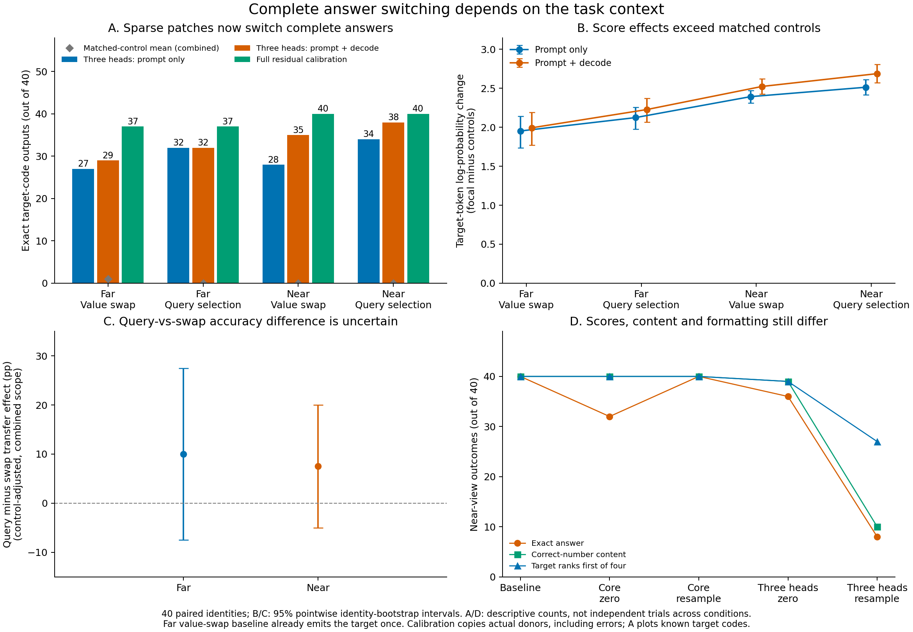

# Publication Multi-Fact And Query-Selection Analysis

Analysis date: 16 October 2026. Results commit: `64b6380`. Both stages used experiment source commit `fcf1cf7e9a50f040861767919f94ab13141a028f` and the frozen [multi-fact protocol](publication_multifact_protocol.md). Original runs, summaries and experimental code are unchanged.

## Decision

**Yes: start drafting the research manuscript now. This study supplies a substantial positive behavioral result and changes the interpretation of the earlier transfer null.**

The same frozen three-head set that changed answer likelihood without transferring complete answers in the earlier tasks now redirects complete answers in new four-fact prose tasks. In the prespecified far query-selection condition, combined patching produces the target code in **32/40 cases**, versus **0/40 for each of its five matched controls**. The control-adjusted transfer effect is **+80 percentage points, with a 95% pointwise interval of [67.5, 90.0]**. The positive control independently reproduces every actual donor output, including its mistakes.

This supports a paper about **task-dependent causal answer steering and the limits of likelihood-based head interpretations**. It does not support either "the heads never transfer complete answers" or "we discovered a universal sparse retrieval circuit." The older null remains valid for its tasks. Here the target code is already present in the recipient document, which creates an important distinction between selecting an available answer and supplying a value absent from that document.

Working title: **From Answer Likelihood to Answer Selection: Auditing Retrieval-Head Interventions in Qwen2.5**. This is a framing proposal, not an established novelty claim. Related-work positioning and the final submission package remain to be completed. A targeted second-model study can proceed alongside writing; another broad sweep is not required before drafting.



The figure uses 40 paired confirmation identities. A reports the known target code, not unconditional agreement with an occasionally incorrect donor. B/C use the frozen, control-adjusted contrasts and pointwise intervals. D contrasts exact generation, correct-number content and four-candidate ranking. A successful patch deliberately redirects a recipient away from its own answer: these transfer counts are not an improvement in ordinary task accuracy.

## Integrity And Positive Control

| Property | Smoke | Confirmation |
| --- | ---: | ---: |
| Independent study identities | 8 | 40 |
| Separate reference identities | 8 | 40 |
| Paired cases | 32 | 160 |
| Condition rows | 1,376 | 6,880 |
| Positive controls matching actual donor tokens and stop | 32/32 | 160/160 |
| Positive-control outputs containing exactly the known target | 28/32 | 154/160 |
| Incorrect donor outputs faithfully reproduced | 4 | 6 |
| Maximum recorded donor-logit error | 0 | 0 |
| Maximum positive/self-patch token-score error | 0 | 0 |
| Elapsed time | 35.51 minutes | 150.46 minutes |
| Peak allocated CUDA tensor memory | 4.205 GiB | 4.208 GiB |

All saved validations, summaries and paired analyses reproduce. Both gzip hashes and uncompressed JSONL hashes match. The full run's smoke provenance matches the supplied smoke. Source hashes match the committed implementation; Qwen model revision, tokenizer, head groups, five control draws, bfloat16 precision, CUDA environment and chunking agree across stages. The earlier specificity confirmation was re-audited for the descriptive comparisons below.

The audit checks every candidate score, generation branch, donor prefix, cache position, intervention scope, hook trace and reference mapping. All study/reference schedules are mutually disjoint and avoid the 345 earlier identities. Cached-tokenizer reproduction regenerates **192 cases and 96 reference prompts exactly**, and re-decodes **all 8,256 generations** to the saved text. No pretrained model was loaded locally.

The full-residual control replaces the current output-side residual before final normalization at every prediction. The full run records 4,960 branch-step logit comparisons, all with zero error; shared initial-step events appear in multiple branch traces, so these are not 4,960 independent interventions. The corresponding count is 992 in smoke. All four candidate score sequences, greedy tokens and termination reproduce the donor.

Crucially, the dense control reproduces **actual behavior**, not an idealized correct answer. The three incorrect far donor outputs occur under both corruption types, accounting for six of the 160 full-run cases. Thus 154/160 target-correct outputs is fully compatible with 160/160 successful positive calibrations. Repeated cases do not turn the confirmation into N=160.

All baselines and positive controls end at EOS. Four full-run intervention rows hit the 64-token limit; all are near-view resampling cases, retained as censored continuations. Two use the three-head group and two use overlapping core controls. Logs are not needed for the scientific assessment of these completed runs. Peak allocated tensor memory is not a measure of GPU utilization.

## Baselines And What Was Changed

| View and corruption | Clean donor correct | Recipient correct for its own question/document | Recipient already emits target |
| --- | ---: | ---: | ---: |
| Far, value swap | 37/40 | 39/40 | 1/40 |
| Far, query selection | 37/40 | 39/40 | 0/40 |
| Near, value swap | 40/40 | 40/40 | 0/40 |
| Near, query selection | 40/40 | 39/40 | 0/40 |

Value swap exchanges the codes of two entities while keeping the question fixed. Query selection leaves the entire document unchanged and changes the requested entity. All four codes occur exactly once in both donor and recipient prompts; the same target and alternate code are used in the paired corruptions. Value swap edits two number spans, while query selection edits a name. Their comparison does not hold the amount or location of corrupted information fixed.

The confirmation spans four held-out prose families, ten identities each, with different wording from the smoke. Prompts are 8,153-8,192 tokens. Far and near versions have equal lengths and token multisets; the source-end-to-question gaps span 7,151-7,332 and 6-109 tokens, respectively, across the four facts. Moving the fact cluster also changes absolute source position, not just distance.

The smoke qualitatively anticipates complete transfer: combined three-head patching gives 4/8 and 6/8 targets for far/near value swap, and 6/8 and 7/8 for far/near query selection. Its clean far baseline is 6/8 and its near baseline 8/8. Smoke stays separate from confirmation: different identities and wording are not pooled to increase N.

## Complete Target-Answer Transfer

Counts below are exact known-target answers under the frozen three-head group `(22,7), (21,11), (22,10)`. Each cell uses the same 40 underlying identities.

| Setting | Recipient baseline | Prompt only | Prompt + decode | Each matched control, combined | Dense control target-correct |
| --- | ---: | ---: | ---: | ---: | ---: |
| Far, value swap | 1 | 27 | 29 | 1 | 37 |
| Far, query selection | 0 | 32 | 32 | 0 | 37 |
| Near, value swap | 0 | 28 | 35 | 0 | 40 |
| Near, query selection | 0 | 34 | 38 | 0 | 40 |

The far value-swap count needs its baseline correction: **29 target outputs include one already present before patching, so 28 are newly induced**. Its fixed-control-adjusted transfer effect is +70 pp [57.5, 82.5], not +72.5 pp. The corresponding effects are +80 pp [67.5, 90.0] for far query selection, +87.5 pp [77.5, 97.5] for near value swap and +95 pp [87.5, 100.0] for near query selection. These are pointwise identity-bootstrap intervals, not simultaneous or multiplicity-adjusted intervals.

No matched patch control induces a new target in either run. The full study has 3,200 dependent control rows, with 20 target outputs that all preserve the one far value-swap baseline error across repeated controls/scopes. This is not 3,200 independent negative trials or proof of a zero population control-transfer rate. Controls do affect likelihood; they are not universally inert. In far query selection, the five combined three-head control deltas range from -0.6011 to +0.2499 per target digit. All draws, including active and overlapping controls, are retained.

L22H7 alone also transfers complete targets, but less often: combined counts are 11/40 and 16/40 for far/near value swap, and 8/40 and 11/40 for far/near query selection. The larger group's stronger behavior is not by itself proof of head synergy or minimality.

For a concrete query-selection example, `dispatch:15100000` associates Rose with `289307` and Emma with `373000`. The clean question requests Rose; the recipient question requests Emma. The unchanged document contains both codes. The recipient answers `373000`; patching the three selected heads from the Rose-question donor changes its complete output to `289307`. This is a question-conditioned causal answer switch, not merely an increase in teacher-forced target likelihood.

### Target code versus actual donor output

The target code is not always what the unmodified donor actually said. Far query-selection patching matches the actual donor sequence in 34/40 cases, but two of those are already-matching incorrect donor/recipient outputs; its target-code count remains 32/40. Far value swap matches actual donor output in 30/40 cases, including wrong outputs, while producing the known target in 29/40. These definitions must not be interchanged to improve a headline.

As a post-run sensitivity analysis, restricting to cases where both clean and corrupt baselines are correct gives **31/36** far query-selection transfers and **28/37** far value-swap transfers. The corresponding near counts are **37/39** and **35/40**. The result is not explained solely by existing baseline errors. These conditional subsets supplement, rather than replace, the prespecified all-40 analysis.

## Query Selection Versus Value Swap

| Three-head combined contrast | Target-token score effect | Exact target-transfer effect |
| --- | --- | --- |
| Far query-selection patch minus controls | +2.2279 [2.0680, 2.3714] | +80.0 pp [67.5, 90.0] |
| Far value-swap patch minus controls | +1.9936 [1.7728, 2.1898] | +70.0 pp [57.5, 82.5] |
| Query minus swap, far, control-adjusted | +0.2343 [0.0710, 0.4062] | +10.0 pp [-7.5, 27.5] |
| Query minus swap, near, control-adjusted | +0.1641 [0.0373, 0.2994] | +7.5 pp [-5.0, 20.0] |

Score effects are mean log-probability changes per target token. The contrasts use within-identity pairing and average the five fixed controls within identity before bootstrapping within task family.

**Both corruptions support substantial transfer. Query selection has a larger estimated control-adjusted likelihood effect, but its apparent advantage in complete-answer transfer is uncertain.** The exact-transfer intervals include zero. This is not evidence of equality, and the protocol does not isolate a pure selection computation from a pure transport computation.

The distinction between raw and control-adjusted scores also matters: far query-selection's raw score gain is +2.0541, compared with +1.9595 for value swap. The adjusted query-minus-swap difference of +0.2343 partly reflects more negative average control effects for query selection; it is not the raw focal difference.

## Distance, Timing And Heterogeneity

Combined three-head effects are stronger near the question. The control-adjusted far-minus-near contrasts are -0.5304 [-0.7474, -0.3387] per digit and -17.5 pp [-32.5, -2.5] exact transfer for value swap; for query selection they are -0.4603 [-0.6036, -0.3296] and -15.0 pp [-30.0, -2.5]. These secondary pointwise intervals do not establish a special long-range-only role.

Some of that comparison includes baseline difficulty. On the same identities with both baselines correct in both positions, combined transfers are 28/37 far versus 32/37 near for value swap, and 31/36 far versus 34/36 near for query selection. Those are post-run descriptive sensitivities, not a replacement distance test.

Timing now affects complete answers, not just scores. Relative to prompt-only patching, continuing the three-head patch during decoding repairs two far value-swap cases, seven near value-swap cases and four near query-selection cases, with no reverse losses. Far query-selection outputs are unchanged between scopes. The first generated token and first-step candidate scores agree across the two scopes, as they should: both perform the same initial intervention.

For example, near query-selection case `archive:15200002` has target `826763` and alternate `357775`. Prompt-only patching generates `826775`; the combined patch generates the complete target `826763`. Another near case changes `735998` versus `508916`: prompt-only yields `708916`, combined yields `735998`. Later interventions can therefore repair hybrid continuations even with the same first generated digit.

Nevertheless, likelihood gains remain heavily concentrated at onset: the first digit contributes 97.8% and 98.3% of the three-head combined sequence-score gains in far value swap and query selection, and 95.2% and 92.9% near. The remaining scores condition on supplied candidate prefixes. A large first-digit share is not proof that the heads only function at the first digit, nor does it explain the full greedy trajectory by itself.

The effect is present in every new family. Far combined target counts by dispatch/archive/workshop/reservation are 8/10, 6/10, 10/10, 5/10 for value swap, and 8/10, 7/10, 10/10, 7/10 for query selection. These small family subsets are descriptive.

Position heterogeneity is important and must not be hidden:

| Target fact position | Far clean baseline | Far value-swap combined | Far query-selection combined | Near query-selection combined |
| --- | ---: | ---: | ---: | ---: |
| First | 10/10 | 6/10 | 10/10 | 9/10 |
| Second | 10/10 | 8/10 | 10/10 | 10/10 |
| Third | 7/10 | 6/10 | 3/10 | 10/10 |
| Fourth | 10/10 | 9/10 | 9/10 | 9/10 |

Seven of eight far query-selection transfer failures involve the third fact; all three far clean-baseline errors also occur there. This post-run observation limits claims of position robustness. It does not isolate position as the causal explanation: each slot contains ten fixed identities with different names, codes and family composition. No cases were removed or heads reselected because of this pattern.

## Ablation, Resampling And Measurement

These interventions act on the clean prompt, which is shared across the corruption types. Counts are out of 40.

| Condition | Far exact / content / four-way rank | Near exact / content / four-way rank |
| --- | --- | --- |
| Baseline | 37 / 37 / 37 | 40 / 40 / 40 |
| Three-head zero | 36 / 36 / 36 | 36 / 39 / 39 |
| Three-head task-matched resample | 13 / 13 / 22 | 8 / 10 / 27 |
| Core zero | 36 / 37 / 37 | 32 / 40 / 40 |
| Core task-matched resample | 37 / 37 / 37 | 40 / 40 / 40 |

The familiar dissociation survives the task change. Near core zero ablation reduces exact output from 40 to 32 while retaining the correct number in all 40 outputs and the correct four-way candidate ranking in all 40. Core resampling preserves exact answers. This supports a formatting-sensitive effect for this intervention and task, not a general claim that the 16-head core has no content-related function.

Three-head zero ablation has modest behavioral consequences: far loses two correct answers but gains one, for a net loss of one; near loses four exact answers, only one of which loses correct-number content. In contrast, three-head resampling leaves 13 exact targets far and eight near. Its control-adjusted exact losses are -60 pp [-75, -45] far and -80 pp [-90, -67.5] near. Resampling is an information-injecting intervention with a different reference document and question, not pure component removal. Its greater damage does not establish strict necessity.

Near three-head resampling also ranks the target highest among the four scored candidates in 27/40 cases while generating an exact target in only 8/40. Teacher-forced candidate ranking is not interchangeable with free generation, even in this improved task design. Two of its near continuations contain the correct number within explanations that hit the token budget; they are not completed compliant answers. Two overlapping core-control rows reproduce one of these long explanations, accounting for the other censored rows.

No focal resampling output contains the complete reference answer, despite the strong aligned-patching transfer result. The separate reference answer is absent from the recipient's four facts, but resampling also differs in alignment, reference content and intervention schedule, so this is not an isolated test of answer availability. Active core controls overlapping the address group are retained; a positive core-minus-control score contrast can mean relative preservation rather than improvement over the baseline.

## Connection To The Full Project

The strongest contrast with the earlier study is behavioral, not a much larger score effect:

| Far three-head combined patch, N=40 per study | Mean target-token score gain | Complete target answers |
| --- | ---: | ---: |
| Earlier specificity, answer replacement | +1.9727 | 0/40 |
| New prose, value swap | +1.9595 | 29/40, including one pre-existing |
| New prose, query selection | +2.0541 | 32/40 |

These are descriptive cross-run comparisons, not paired estimates. The earlier recipient did not contain the target code; every new recipient does. Prose, task families, competing facts and corruption also change together. **Answer availability is a plausible explanation to investigate, not a cause isolated by these experiments.** The query-selection manipulation does establish that changing the selected internal states can redirect the output between facts in an otherwise identical document.

The cumulative argument is now:

1. The historical atlas identified intervention-sensitive heads and candidate groups. It was discovery, not proof of a complete circuit.
2. Raw/chat and boundary tests showed that answer likelihood, initial number content and output formatting can disagree sharply.
3. Held-out confirmation and temporal tests established reproducible score effects without complete transfer under the original answer-replacement tasks.
4. Specificity and full-residual calibration ruled out a simple inability of the pipeline to reproduce donors, while showing that effects are not confined to long source-query gaps.
5. The new held-out multi-fact study shows substantial complete answer switching with the same frozen heads when selecting among present facts, including a query-only manipulation.

The defensible synthesis is **conditional behavioral efficacy**: what a retrieval-head intervention establishes depends on the task, corruption, metric and intervention timing. The new positive finding belongs at the center of the manuscript; the earlier nulls and measurement controls explain its scope. Internal labels such as "answer-address" and "non-address core" should not be presented as already established functional anatomy.

## Manuscript Readiness And Next Work

Proceed with a focused single-model manuscript. The next deliverable should be a claims-and-evidence outline, then Methods and Results; Introduction and Abstract should reflect the final claim hierarchy. Reuse the capstone's background and historical setup where accurate, but replace its stronger mechanism narrative with the audited research conclusions.

Four main figure stories are sufficient: measurement/boundary disagreement; timing and positive calibration under the original task; complete transfer in the new multi-fact tasks; and the paired task/distance plus ablation controls. Put exploratory atlas sweeps, per-family/position details, complete control draws and failure ledgers in appendices. Distinguish the pre-outcome protocol from post-run diagnostics throughout.

One targeted second-model-family replication remains the planned strengthening step, with separate discovery and held-out confirmation rather than copied head indices. It can run during drafting. Single-model scope, four synthetic prose families, six-digit answers and N=40 remain explicit limitations of the present result. We have not established novelty exhaustively, peer-review acceptance, general natural-document performance, or a minimal/necessary/sufficient retrieval circuit.

A matched answer-present/answer-absent manipulation within the same new prose would be needed **if** the paper claims that availability causes the difference from the earlier null. That stronger mechanism claim is optional: the current paper can report the task dependence and label the explanation as a hypothesis. This is not a new prerequisite or an open-ended experiment queue before writing.

## Reproduction

```bash
# Only if the historical specificity trace has not already been extracted:
gzip -dk artifacts_publication/specificity_confirmation_8192/rows.jsonl.gz

.venv/bin/python scripts/diagnose_publication_multifact.py \
  --verify-tokenizer \
  --figure-dir artifacts_publication/figures

.venv/bin/python -m unittest discover -s tests -v
```

The new multi-fact traces stay compressed and are read directly. The tokenizer option uses cached pinned files, not pretrained weights. The diagnostic script saves a separate `multifact_confirmation_8192_diagnostics.json` with audits, input hashes, paired contrasts, token decompositions, baseline-success sensitivities, position/family breakdowns, output transitions and failure ledgers. It generates PNG and vector-PDF figures without rewriting original run artifacts. Terminal logs are unnecessary unless a separate operational error needs investigation.

All **105 local tests pass**, including ten new diagnostic tests for baseline coincidences, incorrect donor reproduction, paired contrasts, position heterogeneity, timing repairs and censored resampling outputs. No new GPU experiment or public manuscript submission was performed in this analysis pass.
