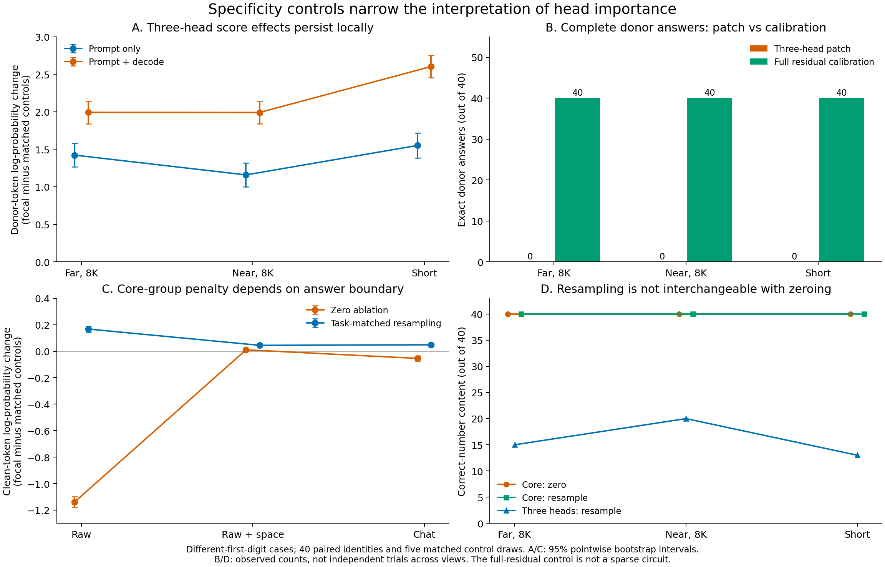

# Publication Specificity And Answer-Boundary Analysis

Analysis date: 16 October 2026. Results commit: `781df96`; lossless trace-storage documentation: `4b571d3`. Both runs used experiment source commit `f584e775c107f9199a9eb04bb49370bacf762115` and the frozen `retrieval-specificity-v1` protocol. Original runs and their analyses are unchanged.

## Decision

**The positive transfer calibration works exactly, but the selected sparse head patches still do not transfer complete answers. Their effects persist on nearby and short tasks. The core group's large raw-continuation score penalty largely disappears when the prompt supplies the answer-leading space, while its initial answer number remains correct even without that repair.**

This is evidence for a narrower paper about what head-importance measurements establish in context-based answer generation, not a validated sparse long-distance retrieval circuit. It strengthens the empirical distinction among answer scores, output initiation, generated content and full donor reproduction. It does not establish that the heads have only one role or that the core is purely stylistic.

Next: a bounded, held-out **new-prose/multiple-fact study with query-selection corruption**, followed by targeted second-family replication. Stop expanding the legacy-template length grid. The intended publication route remains an appropriately scoped arXiv preprint, then TMLR; neither submission nor acceptance has occurred.



All panels use different-first-digit cases. Panels A/C use frozen focal-minus-control contrasts and 95% pointwise identity-bootstrap intervals. B/D show observed counts on the same 40 identities; repeated views are not independent samples. D's core zero/resample content counts coincide at 40, although their exact-format counts differ.

## Integrity And Positive Calibration

| Property | Smoke | Confirmation |
| --- | ---: | ---: |
| Independent study identities | 5 | 40 |
| Separate resampling-reference identities | 5 | 40 |
| Paired cases | 40 | 320 |
| Condition rows | 1,580 | 12,640 |
| Positive controls reproducing donor token sequence and stop | 40/40 | 320/320 |
| Maximum recorded donor/recipient logit error | 0 | 0 |
| Maximum positive-control token-score error | 0 | 0 |
| Maximum self-patch token-score error | 0 | 0 |
| Total elapsed time | 28.43 minutes | 229.70 minutes |
| Peak allocated CUDA tensor memory | 4.21 GiB | 4.21 GiB |

All saved validations, summaries and paired analyses reproduce exactly. Audits include complete grids; model/tokenizer/package identity; source hashes against Git; prompt/input hashes; answer-only corruption; task/reference pairing; fixed controls; per-token score arithmetic; generated metrics; and every saved intervention scope, donor prefix, cache position, hook check and positive logit comparison. The full run's smoke gate matches the supplied smoke. Study/reference schedules are mutually disjoint and avoid all 255 earlier identities checked.

The full 152,238,787-byte trace is preserved in `rows.jsonl.gz`, with an ignored extracted `rows.jsonl` for the unchanged analyzer. Decompressed bytes match the original manifest hash. Compression removed no scientific evidence. The 40 reference donors and five smoke identities are not added to the confirmation's N=40.

The tokenizer-only reproduction regenerates all 360 cases and 225 reference prompts exactly and checks all 14,220 generated token sequences against their saved decoded text. It loads the pinned tokenizer, not pretrained model weights. The earlier temporal confirmation and 8K chat confirmation were separately re-audited for cross-run comparisons.

The positive intervention replaces the entire current-position residual immediately before final normalization, at every prediction, with the unpatched donor's residual. Donor and recipient consume the same actual generated prefix; known answers are not supplied to greedy generation. This broad output-side calibration demonstrates that the implementation can reproduce the donor, including later tokens and termination. It does **not** validate a sparse circuit, prove that every conceivable head intervention is correctly designed, or establish a retrieval mechanism.

In the full run, the 240 chat positive-control cases produce the exact donor answer. All 80 raw/raw-space cases reproduce their donor's actual output, including punctuation or explanations; 20 of these reproduce a donor token-budget stop. Exact six-digit success is not required for those raw positive controls. These counts repeat the same 40 identities.

All chat clean and corrupt baselines succeed: 40/40 in each view and corruption stratum. Every chat generation, including interventions, ends at EOS. Raw conditions account for all 620 full-run token-budget stops; all are retained. Terminal logs are not needed for this completed scientific analysis. Peak allocation is not a GPU-utilization measurement.

The smoke is qualitatively consistent but stays separate. Its combined three-head score deltas are +1.7822 far, +1.8008 near and +2.4649 short, with no full donor transfer. Core zero deltas are -1.1928 in raw and -0.0027 in raw-space; core resampling preserves all five chat answers in each view. Three-head resampling is more damaging in this small sample (0/5, 1/5 and 0/5 correct far/near/short). These five identities check execution and reveal variability, not an additional independent confirmation or a reason to pool the samples.

## Distance Does Not Confine The Effect

Far and near chat prompts contain the same tokens and have exactly matched lengths, 8,208-8,210 tokens. The source-end-to-question gap changes from 7,291-7,327 tokens to 24. Short prompts have 101-119 tokens with the same 24-token gap. The fact still precedes the unrelated distractor note in all views. Source position changes with distance; short prompts also remove irrelevant context.

The table gives changes in mean donor-answer log-probability per digit, relative to the corrupt baseline. These are not accuracy changes. Every cell uses the same 40 identities with different-first-digit corruption.

| Group and scope | Far, 8K | Near, 8K | Short |
| --- | ---: | ---: | ---: |
| L22H7, prompt only | +1.1516 | +1.0101 | +1.3343 |
| L22H7, prompt + decode | +1.5471 | +1.7223 | +2.3016 |
| Three heads, prompt only | +1.4065 | +1.1470 | +1.5378 |
| Three heads, prompt + decode | +1.9727 | +1.9782 | +2.5879 |

The effects exceed matched controls in all these views. The frozen control-adjusted three-head contrasts are:

| Paired interaction | Estimate | 95% pointwise CI |
| --- | ---: | --- |
| Far minus near, prompt only | +0.2636 | [0.1767, 0.3530] |
| Far minus near, prompt + decode | +0.0013 | [-0.1101, 0.1228] |
| Far minus short, prompt only | -0.1287 | [-0.2201, -0.0368] |
| Far minus short, prompt + decode | -0.6106 | [-0.7436, -0.4740] |

There is a real estimated far/near difference under prompt-only patching; it must not be erased by saying "distance never matters." But combined three-head patching is comparable in far and near contexts, and stronger in the short task. The interval spanning zero is not a formal equivalence test. L22H7's combined effect is also stronger nearby: far-minus-near -0.2080 [-0.2930, -0.1172]. These results do not support a simple far-specific or monotonically distance-dependent role.

The shared-first-digit stratum reinforces this conclusion. Combined three-head score deltas are +0.8910 far, +1.0732 near and +1.3569 short. The control-adjusted far-minus-near contrast is -0.1777 [-0.2457, -0.1062]. The intervention still causally affects later-token scores, so "these heads only affect digit one" remains too strong.

### Generated answers

Every focal group, scope, view and corruption stratum has **0/40 complete donor answers**. Across all sparse focal/control patches there are zero exact donor answers and zero exclusive donor-number content matches in 5,760 dependent condition rows. Inspection also finds no full donor number anywhere in those outputs. All complete donor-versus-recipient candidate-score margins remain negative.

The combined three-head patch retains the exact recipient answer in 7/40 far, 16/40 near and 11/40 short different-first cases. It outputs the exact unrelated distractor in 4, 1 and 2 cases respectively. Other changes are partial, shifted or otherwise wrong numbers, not full donor transfers. The broad residual positive control succeeds in every corresponding case.

Shared-first focal patches leave all far and near answers unchanged. In short chat, one identity (`alias:13200000`) changes recipient `856552` to the shortened `85652` under combined L22H7 and three-head patching. The same failure occurs for the frozen L22H10 control. It is not a donor transfer: the donor is `842527`.

Thus the sparse-transfer null is no longer plausibly attributed simply to a pipeline incapable of donor reproduction. It remains conditional on the selected heads, sites, corruption and tasks. It does not prove an intrinsic inability of these heads to participate in retrieval or copying, nor a zero population transfer rate.

## Answer Boundary Explains A Large Score Penalty

All raw clean baselines generate a leading space; no raw-space baseline generates that leading whitespace. Bare raw continuation has mean first-digit log-probability -12.4189. Supplying one space in the prompt raises it to -0.0083. The corresponding six-digit mean scores change from -2.0764 to -0.0022, without making the raw answers exactly six digits: punctuation and explanations remain.

The single trailing space is input context, not a generated token. It also changes the final input position/token and therefore the activation being intervened on. It is a controlled boundary manipulation, not an isolated change to an evaluation formula.

| Core zero ablation, n=40 | Raw | Raw + one space | Chat |
| --- | ---: | ---: | ---: |
| Mean clean-token score delta | -1.1981 | -0.0045 | -0.0841 |
| Focal-minus-matched-control delta | -1.1389 | +0.0101 | -0.0545 |
| Correct first six-digit number | 40/40 | 40/40 | 40/40 |
| Correct-number content with no competing number | 33/40 | 37/40 | 40/40 |
| Exact six-digit answer | 0/40 | 0/40 | 30/40 |
| Token-budget stops | 40/40 | 11/40 | 0/40 |

The frozen raw-space-minus-raw **control-adjusted** core-ablation interaction is +1.1491 [1.1083, 1.1920] log-probability units per digit. Approximately 99.86% of the raw core-ablation sequence-score loss is at the first digit: -7.1783 there versus -0.0103 summed over the remaining five supplied digits.

Raw baseline exclusive-number content is already only 36/40, even though the correct number comes first in all 40. Some explanations later repeat the explicitly unrelated distractor. Under core ablation, seven outputs mention a competing six-digit number after initially giving the correct answer. That is a real failure to obey the requested output contract, but not evidence that the initial retrieved number disappeared. The first-number diagnostic is a post-run addition, not a replacement for the frozen exact/content metrics.

For example, gold `823591` is initially generated as ` 823591.`. Zeroing the core leaves that opening intact but extends it into an explanation that reaches the 64-token budget. Appending the prompt space removes almost all the digit-score penalty and mostly restores normal stopping, but does not remove the raw baseline's punctuation. Raw exact match is at floor before and after intervention, so an exact-accuracy repair cannot be inferred from this comparison.

Budget-limited outputs are censored continuations, not complete responses. Their saved text can support claims about numbers already emitted, but not eventual stopping or what would happen after token 64. Further lengthening raw generation is not needed to establish this particular boundary/initial-number distinction.

## Core Effects And Resampling

| Clean chat intervention, n=40 | Far exact / content | Near exact / content | Short exact / content |
| --- | --- | --- | --- |
| Baseline | 40 / 40 | 40 / 40 | 40 / 40 |
| Core zero | 30 / 40 | 30 / 40 | 40 / 40 |
| Core task-matched resample | 40 / 40 | 40 / 40 | 40 / 40 |
| Three-head zero | 40 / 40 | 40 / 40 | 40 / 40 |
| Three-head task-matched resample | 15 / 15 | 20 / 20 | 13 / 13 |

Core zero ablation makes ten long-context answers explanatory in each position condition; all retain the correct number. Six of those failing identities overlap between far and near, so the equal aggregate counts do not imply identical behavior. Far failures occur in literal/relational questions; nearby failures in literal/paraphrase questions. Eight examples per variant are descriptive, not grounds for broad semantic-family claims.

The unadjusted core score deltas across far/near/short chat are -0.0841, -0.0873 and -0.0345. The control-adjusted far-minus-near contrast is +0.0194 [-0.0006, 0.0378], while far-minus-short is -0.0389 [-0.0613, -0.0171]. Context length, irrelevant content and interface are plausible contributors; source-query distance alone does not explain the observed wording failures.

Task-matched core resampling is almost null in absolute score change (-0.0004, -0.0005 and -0.0002 across chat views) and preserves exact output. This is consistent with the selected core activations being relatively substitutable across these task-matched identities at this site. It is not proof that the core contains no task/answer information.

Conversely, resampling the three-head group changes answer content substantially in every chat distance condition. Relative to its five controls, exact/content loss is 62.5 percentage points [47.5, 75.0] far, 50.0 [37.5, 62.5] near and 67.5 [55.0, 77.5] short. Its sampled controls retain all 40 answers in each condition. No focal resampling response contains the full reference answer, even as part of longer text.

For gold `608948` and resampling-reference answer `549393`, far-chat three-head resampling generates `560894`. Another case changes `823591` to `123591` using a reference answer of `143660`. These are competing/partial output effects, not clean six-digit substitution. The donor also differs in task details and filler. Resampling is an intervention that can inject incompatible information, not simply a more natural version of removing a component; its greater damage does not by itself prove necessity or isolate a unique computation.

Keep the stronger controls. Core-control resampling is damaging mainly in draws 1 and 3, which overlap the frozen address group. Their far exact counts are 36/40 and 19/40, compared with 40/40 for the other draws. The actual core is therefore *less* harmful than its control mean under resampling. Positive focal-minus-control contrasts here mean relative preservation, not an improvement over the unmodified model. Removing those active controls would change the frozen comparison unjustifiably.

## Connection To Earlier Results

The far-chat patch effects replicate the temporal run closely on fresh identities despite minor uniform-block prompt differences:

| Different-first condition | Temporal n=40 | Specificity far n=40 |
| --- | ---: | ---: |
| L22H7 prompt only | +1.2116 | +1.1516 |
| L22H7 prompt + decode | +1.6593 | +1.5471 |
| Three heads prompt only | +1.4523 | +1.4065 |
| Three heads prompt + decode | +2.0502 | +1.9727 |
| Complete donor answers | 0 in each cell | 0 in each cell |

These are descriptive cross-run comparisons, not paired protocol-effect estimates. The generation budget changed from 24 to 64, though every chat output still reaches EOS. The original group definitions, model revision, tokenizer and GPU package versions match.

Core zero ablation also continues the earlier distinction: the 160-identity unmarked confirmation retained 137 exact and 156 content-correct answers, versus 30 exact and 40 content-correct here. This new batch does **not** reproduce the earlier three-head zero-ablation answer failures (previously 153/160 exact, seven failures). It has 40/40 exact in far chat. Do not erase the earlier failures or claim universal necessity from either batch; sample composition and minor prompt changes both differ.

The accumulated sequence is now:

1. **Historical atlas:** identified intervention-sensitive heads and candidate groups, but its score did not establish complete-answer transport.
2. **Raw/chat pilots:** exposed answer-boundary sensitivity and score/content/format disagreement.
3. **Held-out 8K confirmation:** replicated selective likelihood/onset effects and showed that stronger matched controls weaken a distinctive core-content claim.
4. **Temporal experiment:** later patches affect later-token scores, but continuing the sparse patch still does not transfer the whole answer.
5. **Specificity experiment:** positive donor reproduction succeeds; sparse effects persist locally; one input space removes most of the raw core penalty; zero and resampled interventions imply different behavioral stories.

The stronger contribution is a carefully delimited empirical audit of retrieval-head interpretations, not "we found content heads and support heads." A promising working title is **Retrieval Head Importance Beyond Answer Likelihood: Boundary, Timing, and Task-Specificity Controls**. This is a framing proposal, not a novelty claim.

## Next Experiment And Publication Gate

### Immediate: new prose and competing facts

Implement one bounded multi-fact runner before another old-template sweep. Use chat, readable prose distractors, several plausible entity-code facts, held-out surface forms and fresh identities. The question should select among answers that are genuinely present, rather than repeat one special sentence against mostly irrelevant word filler. Balance fact order and queried identity so answer position does not reveal the correct choice.

Use two complementary paired corruptions on the same underlying documents:

- **Answer-value substitution:** keep the queried entity/relation fixed while changing its code, preserving the previous intervention interpretation.
- **Query-selection substitution:** keep every fact and candidate code fixed while changing which entity is requested. This directly tests selection among available facts rather than only transport of a replaced value.

Verify equal donor/recipient token lengths and aligned intervention positions; choose token-compatible query aliases before outcomes, not by task success. Keep prompt-only/combined sparse patches, self-patches, the full-residual positive control and all frozen matched draws. Include core zero/resampling only where it addresses the proposed role comparison; do not automatically cross every old interface and context length. Score all competing fact values and retain free generation, exact/content/first-number endpoints, per-token scores and EOS/budget state.

A reasonable starting budget is a small engineering smoke, then 40 fresh document identities spanning several new template families, paired far/near conditions and both corruption types. This is a proposal, not an already frozen protocol or power calculation. Predefine seeds, templates, primary contrasts and failure handling before the confirmation. If baseline performance is poor, diagnose it in the smoke; do not cherry-pick successful full-run examples. Scope the study to number-valued factual lookup unless additional answer types are actually tested.

The decision gates are scientific rather than significance hunting:

- If frozen-head effects persist under new prose and query-selection corruption, the case extends beyond the original answer-substitution templates. Distinguish selection effects from complete transfer.
- If they fail, report that boundary and narrow the preprint to this controlled case study. New head discovery would need a separate discovery split and untouched confirmation, not reuse of these outcomes as a validation set.
- If the positive calibration fails, stop interpretation and debug it. If baselines fail, retain and report failures rather than redefine success.

### Then: replication and manuscript

After this bounded task test, run a targeted second-family replication with a separate discovery/confirmation split. Literal head indices must not be transferred across models. Use a small performance/hook smoke before committing A10G time. No particular second model or measured fit/runtime is asserted here.

Start the research manuscript in parallel with these experiments. Use three or four principal figures for measurement/behavior, temporal effects, the present controls and task replication; place historical sweeps and full condition tables in appendices. A clearly scoped single-model arXiv version need not wait indefinitely for every experiment, but the broader journal claim should benefit from the task/model checks. Do not upload the capstone mechanism narrative unchanged.

The general fact that metric/corruption choices change patching interpretations is established prior work, not our novelty: see [Zhang and Nanda, ICLR 2024](https://arxiv.org/abs/2309.16042) and [Heimersheim and Nanda](https://arxiv.org/abs/2404.15255). A refreshed related-work comparison must explain the additional empirical result and reusable evaluation lesson, not merely list those papers. This pass checked those primary sources, not an exhaustive new literature search.

The arXiv-first/TMLR route remains compatible with [TMLR's current author guidelines](https://jmlr.org/tmlr/author-guide.html), checked on 16 October 2026: identified preprints are allowed, while the review submission and supplementary material must remain anonymous. Prepare that separate research artifact, author/account details and reproducibility package; no new deadline or acceptance promise is made here.

## Reproduction

```bash
# Only on a fresh checkout where rows.jsonl has not been extracted:
gzip -dk artifacts_publication/specificity_confirmation_8192/rows.jsonl.gz

.venv/bin/python scripts/diagnose_publication_specificity.py \
  --verify-tokenizer \
  --figure-dir artifacts_publication/figures

.venv/bin/python -m unittest discover -s tests -v
```

The tokenizer flag uses only cached tokenizer files. Omit it for numerical/artifact analysis without local tokenization regeneration. The script never rewrites the original runs. It saves `artifacts_publication/specificity_confirmation_8192_diagnostics.json`, including audits and hashes, separate smoke summaries, per-token decompositions, control overlaps, full baseline and changed-focal-output ledgers, paired contrasts and earlier-run comparisons. The new figure is saved as PNG and vector PDF. All 74 local tests pass, including new artifact-regression tests. No pretrained GPU job or public submission was performed in this analysis pass.
