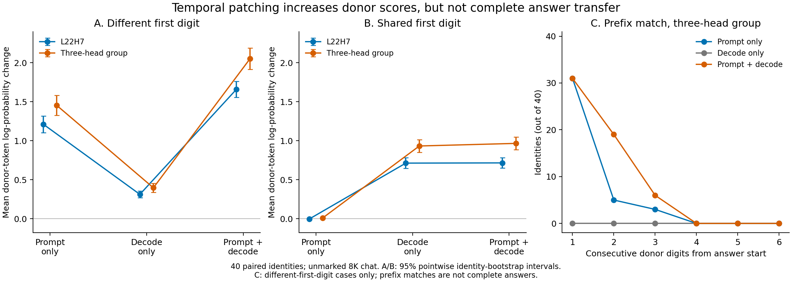

# Publication Temporal Patching Analysis

Analysis date: 15 October 2026. Results commit: `b448d55`. Both runs used experiment source commit `61c5eccf6da9bb4469124f024d207082c04268b7` and the frozen `retrieval-temporal-v1` protocol. This analysis does not modify either run or the previous confirmation.

## Decision

**Continuing the selected head patches during decoding increases donor-answer likelihood, and sometimes extends the donor-matching generated prefix, but still does not transfer a complete donor answer.** The negative transfer result is not explained simply by removing the intervention after the first prediction. This statement is limited to these heads, intervention site, corruption design, model, and tasks.

The result also rules out describing the heads as affecting *only* the first digit: their later-position patches measurably affect later-token probabilities. The distinction is between causal influence on scores or partial output and sufficient control of a complete generated answer.

Proceed with the planned **answer-start and local-task specificity controls**, adding a deliberately broad positive transfer calibration. Do not scale context length, search for a new favorable head set on these outcomes, or revive a complete-retrieval-circuit claim. The publication direction remains a careful empirical study of what different head-importance measurements establish, with the atlas as its starting point.



Panels A/B show changes from the corrupt baseline, not changes in accuracy. Their intervals are pointwise, identity-level bootstrap intervals. Panel C is an additional post-run prefix diagnostic, not a substitute for full-answer exact match.

## Integrity And Denominators

| Property | Smoke | Full confirmation |
| --- | ---: | ---: |
| Independent identities | 5 | 40 |
| Identities per legacy variant | 1 | 8 |
| Paired corruption cases | 10 | 80 |
| Conditions per case | 44 | 44 |
| Complete condition rows | 440 | 3,520 |
| Total elapsed time | 9.11 minutes | 71.28 minutes |
| Peak allocated CUDA tensor memory | 4.21 GiB | 4.21 GiB |
| Realized prompt lengths | 8,209-8,210 | 8,208-8,211 |
| Generations ending at EOS | 440/440 | 3,520/3,520 |
| Self-patch maximum per-token score error | 0 | 0 |

All saved validation reports, summaries, and paired analyses reproduce exactly. Checks include the complete nonduplicated grid; source hashes against the recorded Git commit; input-file and prompt hashes; fixed head/control draws; reserved seeds; answer-only corruption; candidate-score arithmetic; generation metrics; and every recorded prefix, cache-position, scope, and hook check. The confirmation's smoke-gate hash and validation match the supplied smoke.

Both runs have identical experiment sources, model revision, tokenizer/chat-template fingerprint, packages, precision, chunking, and groups. The model and package versions also match the earlier 8K chat confirmation. The manifest's untracked smoke directory is not an experiment-code change. No temporal identities overlap the 210 historical/publication identities checked, and the smoke and full stages are disjoint.

A separate tokenizer-only local check regenerated all **90 saved cases exactly** and decoded all **3,960 generated token sequences** back to their saved text. It used the cached pinned tokenizer, not pretrained model weights. The earlier 8K confirmation was also re-audited for the cross-run comparison.

The full-run clean baseline succeeds on **39/40 identities**, and both corrupt baselines succeed on **40/40**. The same clean error appears in both corruption strata: `literal:11100006`, gold `820334`, output `820345`. The prompt genuinely contains `820334`; the unrelated distractor is `239581`. This is one baseline failure repeated twice, not two independent failures. It remains in every primary analysis. A 39-identity baseline-success sensitivity analysis still has zero complete transfers and similar score effects.

All smoke baselines succeed, but the smoke's five identities are not pooled into the confirmation. The full experiment has **40 independent units**, not 80, 480 focal patch rows, or 2,880 total patch rows. Terminal logs are not needed for this completed scientific analysis. Peak allocated memory is not a GPU-utilization measurement.

## The Three Scopes

- `prompt_only`: patch the final prompt position that predicts the first answer digit; subsequent decoding is unpatched.
- `decode_only`: leave the first prediction alone; patch subsequent decoding positions.
- `prompt_and_decode`: patch both the first prediction and subsequent decoding, including the prediction of EOS.

There are no document-prefill interventions. At each step the unpatched clean-context donor receives the same prefix actually consumed by the corrupt-context recipient. Free generation never feeds the known donor answer. The three teacher-forced candidate branches are separate from greedy generation.

Each identity has two answer-only corruptions: `different_first` changes digit one, while `same_first` keeps digit one and changes digit two. The clean fact, query, filler, and unrelated distractor remain the same across the paired corruptions. Later-only intervention cannot repair an already emitted wrong first digit, which is why the shared-first-digit condition matters.

### Likelihood effects

Values below are mean changes in donor-answer log-probability **per digit**, relative to the corrupt baseline. They are not accuracy percentages. Every cell uses the same 40 paired identities.

| Corruption | Group | Prompt only | Decode only | Prompt + decode |
| --- | --- | ---: | ---: | ---: |
| Different first digit | L22H7 | +1.2116 | +0.3126 | +1.6593 |
| Different first digit | Three-head address group | +1.4523 | +0.3970 | +2.0502 |
| Shared first digit | L22H7 | -0.0036 | +0.7130 | +0.7160 |
| Shared first digit | Three-head address group | +0.0107 | +0.9328 | +0.9659 |

The three-head group is the previously frozen L22H7, L21H11, and L22H10. Its likelihood gains occur in every variant under combined patching, but per-variant samples contain only eight identities.

Relative to each group's mean of five fixed layer/count-matched controls:

| Corruption | Group | Prompt-only contrast, 95% CI | Decode-only contrast, 95% CI | Combined contrast, 95% CI |
| --- | --- | --- | --- | --- |
| Different first | L22H7 | +1.1223 [1.0184, 1.2245] | +0.3047 [0.2605, 0.3502] | +1.5653 [1.4618, 1.6681] |
| Different first | Three heads | +1.4606 [1.3340, 1.5908] | +0.4049 [0.3458, 0.4680] | +2.0696 [1.9279, 2.2101] |
| Shared first | L22H7 | -0.0005 [-0.0063, 0.0053] | +0.7054 [0.6397, 0.7716] | +0.7039 [0.6383, 0.7710] |
| Shared first | Three heads | +0.0132 [0.0036, 0.0233] | +0.9815 [0.8995, 1.0639] | +1.0152 [0.9352, 1.0941] |

The small shared-first prompt-only three-head contrast should not be described as exactly zero; it is much smaller than the effects of decoding intervention. Intervals use the frozen 4,000-draw variant-stratified paired bootstrap. They are pointwise, not multiplicity-adjusted, and condition on the five sampled controls. Control draws are not extra examples.

L22H10, one of L22H7's single-head controls, remains active in the likelihood readout: different-first combined patching gives +0.4672. It is retained in the control average. Every sampled control still generates the recipient answer in all scopes and both strata. Controls are not labeled inactive merely because they produce no greedy answer changes.

### Generated answers

**Complete donor transfer is 0/40 in every focal scope and corruption stratum.** Across all focal and control patches, it is 0/2,880 condition rows; these rows are dependent repetitions. The sole-number and repeated-identical-number content diagnostics also find zero full donor numbers. All donor-versus-recipient full-answer likelihood margins remain negative; their maximum is -3.9845.

| Different-first cases, n=40 | Exact recipient | First digit matches donor | First two digits match donor | First three match donor | Complete donor |
| --- | ---: | ---: | ---: | ---: | ---: |
| L22H7, prompt only | 33 | 7 | 0 | 0 | 0 |
| L22H7, decode only | 40 | 0 | 0 | 0 | 0 |
| L22H7, prompt + decode | 33 | 7 | 2 | 0 | 0 |
| Three heads, prompt only | 9 | 31 | 5 | 3 | 0 |
| Three heads, decode only | 40 | 0 | 0 | 0 | 0 |
| Three heads, prompt + decode | 9 | 31 | 19 | 6 | 0 |

No focal output matches the first four donor digits. In the shared-first-digit stratum, **all three scopes and both groups leave all 40 recipient answers unchanged**, including the second digit. Across both strata, decode-only intervention leaves every focal and control generated token sequence unchanged from the corrupt baseline.

Adding decode patches to prompt patches changes 20/40 three-head outputs and 4/40 L22H7 outputs in the different-first stratum. The three-head two-digit-prefix count increases from 5 to 19, a post-run paired diagnostic of +35 percentage points [22.5, 47.5]. The three-digit-prefix increase is smaller, +7.5 points [0, 15]. These are prefix matches, not full-answer recovery or proof that those digits uniquely came from the donor source. Two of the six three-digit-prefix matches are actually unrelated-distractor answers.

For example:

| Donor | Recipient | Prompt-only three-head output | Prompt + decode output |
| --- | --- | --- | --- |
| `206547` | `389193` | `289193` | `209193` |
| `273955` | `361495` | `261495` | `273159` |
| `154243` | `433548` | `123456` | `154896` |

These outputs are not all simple donor-prefix/recipient-suffix splices. Some are other numbers, shortened outputs, or distractors. Four identities output the exact unrelated distractor under both prompt-only and combined three-head patching. For example, donor `360884`, recipient `602609`, and distractor `360238` produce `360238` in both scopes. The distractor shares a prefix with the donor, making prefix-only interpretation especially unsafe.

Different-first three-head outputs remain exactly six digits in 36/40 prompt-only and 34/40 combined cases. The remaining outputs terminate at EOS, not at the token budget. Combined patching is therefore not uniformly a behavioral improvement. A donor answer in a corrupted document would in any case be **answer transfer**, not improved correctness on that recipient's document.

## Why Larger Scores Do Not Become Complete Answers

For six answer digits, the mean score change is the sum of the six token log-probability changes divided by six. The saved token scores expose where it comes from:

| Three-head intervention | Digit 1 delta | Digit 2 delta | Digits 3-6 summed delta | Six-digit summed delta |
| --- | ---: | ---: | ---: | ---: |
| Different first, prompt only | +11.5434 | -1.7235 | -1.1062 | +8.7137 |
| Different first, decode only | 0 | +1.0195 | +1.3623 | +2.3819 |
| Different first, combined | +11.5434 | +0.3939 | +0.3640 | +12.3012 |
| Shared first, prompt only | +0.0005 | +0.0766 | -0.0127 | +0.0643 |
| Shared first, decode only | 0 | +3.8499 | +1.7466 | +5.5965 |
| Shared first, combined | +0.0005 | +4.0405 | +1.7546 | +5.7956 |

The shared-first stratum directly shows a later-position effect: L22H7 decode-only patching raises the second donor digit's log-probability by +3.0843 on average, and the three-head patch raises it by +3.8499. This cannot be dismissed as solely a first-token score shift.

However, in the three-head decode-only condition, the mean probability of that second donor digit is still just **0.000080**, or **0.0080%**. Its maximum is about **0.2473%**. The competing recipient second digit has mean probability **99.9868%**. The shared first digit means these second-token probabilities are evaluated on the same prefix, also the prefix actually generated here. An increase from a very small probability can look large in log space while remaining far below the greedy decision boundary.

Later teacher-forced scores use the supplied candidate's prefix, which may already differ from the greedy trajectory. They are not evidence that the model would freely emit that prefix. Continued patching in the different-first condition changes some greedy trajectories after their first token has changed, but does not give sustained control over the complete six-digit answer.

The newly included distractor scores help interpret failures, but do not make candidate scoring equivalent to open-ended generation. Eleven patch rows favor the donor over the distractor while still generating no donor answer. The clean baseline error also has positive donor-versus-recipient and donor-versus-distractor margins despite outputting a fourth number. Always retain generated text alongside all candidate scores.

## Connection To Earlier Evidence

The new prompt-only arm closely reproduces the earlier 8K unmarked result when compared within the descriptive first-digit subgroups:

| Group and subgroup | Earlier unmarked confirmation | New prompt-only temporal arm |
| --- | ---: | ---: |
| L22H7, different first | +1.1774, n=141 | +1.2116, n=40 |
| Three heads, different first | +1.4454, n=141 | +1.4523, n=40 |
| L22H7, shared first | +0.0061, n=19 | -0.0036, n=40 |
| Three heads, shared first | +0.0265, n=19 | +0.0107, n=40 |

The earlier subgroups were different identities with naturally occurring shared prefixes, potentially longer than one digit. The temporal design pairs the same 40 identities across two controlled corruption strata, with exactly one shared leading digit in `same_first`. Cross-run numbers are descriptive replication, not a paired causal estimate of a protocol change.

The evidence now fits the following progression:

1. **Historical atlas:** identifies promising causal intervention targets; it does not by itself establish that a head group carries a complete answer.
2. **Raw/chat pilots:** expose answer-boundary sensitivity and a difference between likelihood, generated content, and output formatting.
3. **Held-out 8K chat confirmation:** replicates selective likelihood/onset effects, correct-number preservation under many core ablations, and some distractor-selection failures. Stronger matched controls weaken a distinctive content-transfer claim for the 16-head core.
4. **Temporal confirmation:** shows later-position causal score effects and some longer donor-matching prefixes, but no full-answer transfer even under continued patches. The simple missing-decoding explanation is insufficient for these selected groups.

The temporal runs contain **patching, not ablation**. They neither establish necessity during decoding nor revisit the core's formatting/content role directly. They also do not test other layers, document-prefill patches, separate Q/K versus V pathways, new templates, ordinary prose, or another model. Unpatched recipient pathways and prefix-dependent behavior are possible explanations, not mechanisms isolated by this experiment.

The single clean-baseline error is not driving the result: excluding that identity only for sensitivity changes the different-first three-head combined mean from +2.0502 to +2.0615, and the shared-first mean from +0.9659 to +0.9637. Complete transfer remains zero. Main tables keep all 40 identities.

## Next Experiment And Publication Plan

### Immediate priority: specificity with a positive calibration

The next implementation should answer **whether these effects are specific to distant retrieval or also occur in ordinary nearby copying and answer initiation**. Use a small smoke before fresh held-out identities; freeze the new protocol before outcomes. Keep the focal heads and existing matched-control draws, do not choose a new group from this batch.

Use two focused panels instead of a full cross-product of every condition:

| Panel | Comparison | What it resolves |
| --- | --- | --- |
| Retrieval distance/task | Unmarked chat with the same fact early in an 8K document, nearby in the same-length document, and in a short local document | Distinguishes long-distance dependence from general context-based number copying. The short condition changes context length as well, so it is not a pure distance contrast. |
| Answer boundary | Raw bare-digit continuation, raw with an explicit leading-space boundary, and chat; prioritize the 16-head core's ablation versus fixed controls | Tests whether apparent support is tied to answer initiation/format rather than distinctive retrieval-content damage. Raw-space and chat are separate manipulations, not interchangeable fixes. |

For the distance panel, preserve the identities, answer pairs, wording, distractor, and filler across far/near conditions. Put the nearby fact immediately before the fixed distractor note and query so the fact still precedes the distractor; do not silently reverse their order. Record actual token counts and source-query distances. Retain both corruption strata, full donor transfer, recipient retention, decoy outputs, per-token scores, and strict versus content diagnostics. Prompt-only and combined patches are the useful primary temporal comparison; another exhaustive timing sweep is not necessary here.

Add a **known-positive transfer calibration**: replace the entire final pre-normalization residual vector from the aligned donor at every answer-generation step. It should reproduce the clean donor's free generation, not necessarily the gold answer on a clean-baseline failure. Check the current-step logits as well as final output tokens. This is deliberately broad and essentially a donor-output calibration, **not a discovered sparse mechanism** or evidence of retrieval specificity. It complements the existing identity/self-patch controls, which test preservation rather than successful transfer. If it fails, debug implementation before interpreting the new sparse-patch comparisons.

For the answer-boundary panel, measure both candidate scores and freely generated content under the same frozen head interventions. Preserve imperfect baselines and report paired effects as well as baseline-success sensitivity. A zero-ablation result alone should not be promoted to a definitive computational-role label; a complementary nonzero replacement control is needed before making a strong claim about the core's function.

The decision rules are substantive, not a search for a desired significance level:

- If comparable effects occur in near/short copying, narrow the interpretation to autoregressive answer production unless a controlled far-minus-near interaction supports long-distance specificity.
- If the core's large raw effect is substantially reduced by an explicit answer boundary, retain the answer-start explanation and drop a retrieval-specific support claim unless content readouts independently support it.
- If sparse groups still fail to transfer whole answers while the broad calibration succeeds, report their measured influence without calling them a sufficient complete-answer pathway.
- If task baselines are weak, retain and diagnose failures before increasing experiment scale; do not quietly filter them away.

### After specificity

Run a bounded held-out task set with **new prose/templates and multiple plausible facts**, including query-selection corruption that changes the requested entity while keeping candidate values present. This addresses both legacy-template dependence and the observed distractor failures. It is more informative now than another Latin-filler 16K sweep.

Then perform a targeted second-family model replication with its own discovery/confirmation split. Literal head indices do not transfer across models. A carefully scoped single-model preprint is possible in principle, but stronger task and model replication would materially improve the case for peer review.

Keep the existing **arXiv preprint, then TMLR** strategy as the intended route; no new venue/deadline research or submission was performed in this pass. Do not upload the older capstone mechanism story unchanged. The research manuscript should center on the demonstrated relationship among scoring, intervention timing, answer boundaries, and generated behavior. General temporal head dynamics and patching-metric caveats are not new by themselves; a refreshed related-work comparison must establish the specific contribution before submission.

We have a more defensible empirical direction, not yet a validated complete circuit or guaranteed publishable novelty. The fastest credible next step is this focused specificity block, followed by the richer-task check, rather than accumulating more of the same measurements.

## Reproduction And Saved Outputs

```bash
.venv/bin/python scripts/diagnose_publication_temporal.py \
  --verify-tokenizer \
  --figure-dir artifacts_publication/figures

.venv/bin/python -m unittest discover -s tests -v
```

The tokenizer flag uses only the locally cached pinned tokenizer and does not load model weights. Omit it to reproduce the numerical/artifact analysis without that optional local cache check. The original six files in each temporal run stay untouched.

`artifacts_publication/temporal_confirmation_8192_chat_diagnostics.json` contains input and analysis-source hashes, 156 condition/variant summaries, the separate smoke summaries, per-digit decompositions, first-differing-token probabilities, preserved baseline failures, scope transitions, the 76 changed-output records, matched-control/scope contrasts, baseline-success sensitivity, and comparison with the earlier 8K run. The scope figure is saved as PNG and vector PDF in `artifacts_publication/figures/`.

All 49 local tests pass, including tiny random CPU-model checks of the frozen runner and new artifact-analysis regression tests. No pretrained GPU experiment, account setup, or public submission was performed locally during this analysis.
